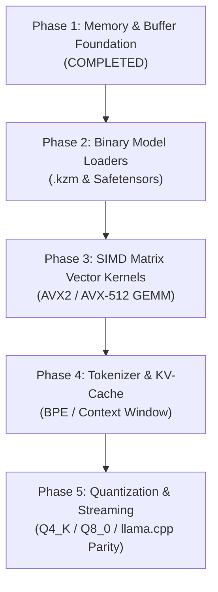

# Kaz AI Engine Roadmap (Revised Architecture)

This document establishes the technical roadmap, architecture milestones, and quantitative acceptance criteria for the native AI / LLM inference engine built into Kaz.

---

## Technical Strategy

The Kaz AI Engine is designed for high-performance, deterministic local inference on CPU (x86-64 with AVX2 and AVX-512 extensions). It leverages Kaz's direct memory buffers, freestanding runtime routines (`libkazrt`), 64-byte aligned SIMD heap allocations, and zero-overhead AOT compilation.

### Baseline Comparison
- **Reference Standard**: `llama.cpp` (clean C/C++ reference CPU inference).
- **Quantized Formats**: GGUF (Q4_K_M, Q8_0) and native `.kzm` (Kaz Model).
- **Target Workloads**: LLaMA-3, Mistral, Qwen, DeepSeek local models.

---

## Roadmap Milestones & Phases

---

### Phase 1: Memory & Buffer Foundation (Completed)
- **Status**: [x] Completed
- **Delivered Capabilities**:
  - SIMD 64-byte aligned memory allocation (`kaz_alloc`).
  - Active heap ceiling protection preventing Linux overcommit OOM crashes (`heap_set_limit`).
  - Tagged buffer bounds checking (`KAZB` tag, overflow protection, safe LE accessors).
  - High-precision fixed-point `decimal` primitive with hardware-accelerated 128-bit integer arithmetic.
- **Done When**:
  - Out-of-bounds buffer loads fail deterministically with exit code 1.
  - Zero performance regression on inner-loop operations.

---

### Phase 2: Binary Model Loaders & Format Validation
- **Status**: In Progress
- **Key Objectives**:
  - Safe memory-mapped model loader (`mmap`) with zero copy.
  - Strict header validation: `data_offset.checked_add(data_len) <= mmap_len`.
  - Native `.kzm` format with embedding dimensions, head counts, and quant type metadata.
- **Done When**:
  - A 7B parameter Safetensors / .kzm file loads in $< 150\text{ ms}$ on SSD via `mmap`.
  - Malformed or truncated model files fail with a clean descriptive error and never segfault.

---

### Phase 3: SIMD Vector Kernels (GEMM / MatMul)
- **Status**: Planned
- **Key Objectives**:
  - Hand-tuned AVX2 / AVX-512 FMA vector dot-products (`vfmadd231ps`).
  - Cache-blocking (L1/L2 tile partitioning) for matrix-vector multiplication (`GEMV`).
  - Multi-threaded CPU execution with lightweight thread worker pool.
- **Done When**:
  - FP32 MatMul reaches $\ge 85\%$ of OpenBLAS single-thread throughput.
  - Multi-threaded scaling achieves $\ge 3.5\times$ on 4 physical cores.

---

### Phase 4: Tokenizer & KV-Cache
- **Status**: Planned
- **Key Objectives**:
  - Fast Byte-Pair Encoding (BPE) and SentencePiece tokenizer in Kaz native code.
  - Ring-buffer KV-Cache for context sequences up to 8K tokens.
  - Memory-efficient Flash-Attention-style CPU kernel.
- **Done When**:
  - Tokenization processes $\ge 500,000\text{ tokens/sec}$.
  - KV-cache allocation matches exact sequence length without memory churn.

---

### Phase 5: Quantization & End-to-End Inference
- **Status**: Planned
- **Key Objectives**:
  - Block quantization support: Q4_K_M (4-bit weights) and Q8_0 (8-bit weights).
  - Streaming token generation with temperature and top-p sampling.
  - CLI runner `kaz ai run model.kzm "prompt"`.
- **Done When**:
  - Generation speed reaches $\ge 70\%$ of `llama.cpp` tokens-per-second on identical hardware.
  - Peak Resident Set Size (RSS) strictly stays within model size + context footprint.
