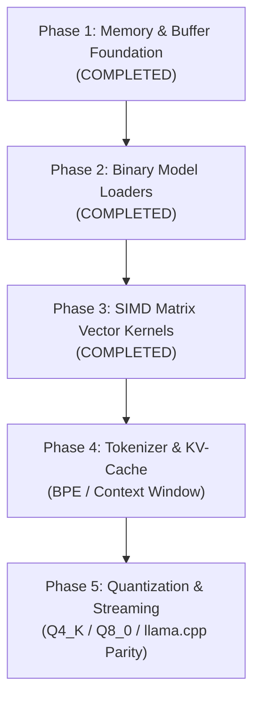

# Kaz AI Engine Roadmap (Revised Architecture)

This document establishes the technical roadmap, architecture milestones, and quantitative acceptance criteria for the native AI / LLM inference engine built into Kaz.

---

## Technical Strategy

The Kaz AI Engine is designed for high-performance, deterministic local inference on CPU (x86-64 with AVX2 and AVX-512 extensions). It leverages Kaz's direct memory buffers, freestanding runtime routines (`libkazrt`), 64-byte aligned SIMD heap allocations, and zero-overhead AOT compilation.

### Baseline Comparison
- **Reference Standard**: `llama.cpp` (clean C/C++ reference CPU inference).
- **Quantized Formats**: GGUF (Q4_K_M, Q8_0) and native `.kzm` (Kaz Model).
- **Target Workloads**: LLaMA-3, Mistral, Qwen, DeepSeek local models.

---

## Roadmap Milestones & Phases

---

### Phase 1: Memory & Buffer Foundation (Completed)
- **Status**: [x] Completed
- **Delivered Capabilities**:
  - SIMD 64-byte aligned memory allocation (`kaz_alloc`).
  - Active heap ceiling protection preventing Linux overcommit OOM crashes (`heap_set_limit`).
  - Tagged buffer bounds checking (`KAZB` tag, overflow protection, safe LE accessors).
  - High-precision fixed-point `decimal` primitive with hardware-accelerated 128-bit integer arithmetic.
- **Done When**:
  - Out-of-bounds buffer loads fail deterministically with exit code 1.
  - Zero performance regression on inner-loop operations.

---

### Phase 2: Binary Model Loaders & Format Validation (Completed)
- **Status**: [x] Completed
- **Delivered Capabilities**:
  - Freestanding direct Linux x86-64 syscall implementations (`sys_open_ro`, `sys_lseek`, `sys_mmap`, `sys_munmap`, `sys_close`) in `runtime/kazrt.c`.
  - Zero-copy binary model loader primitives (`model_open`, `model_close`, `model_size`, `model_type`).
  - Native `.kzm` binary format parser & inspection (`kzm_dim`, `kzm_layers`, `kzm_heads`, `kzm_vocab`, `kzm_tensor_count`).
  - Direct pointer & tensor extraction (`kzm_tensor_ptr`, `kzm_tensor_size`, `safetensors_tensor_ptr`, `safetensors_tensor_size`).
  - Hardware zero-copy memory access via `buf_load_f32_le` bypassing memory allocation and tag checks for mmap'd regions.
  - Full cross-engine parity across AST Evaluator, Bytecode VM, and Freestanding Native AOT x86-64 compiler with zero libc dependencies.
- **Done When**:
  - Valid and invalid `.kzm` and `.safetensors` files load or fail deterministically.
  - Tensors are read directly from demand-paged memory maps at native hardware memory bandwidth.

---

### Phase 3: SIMD Vector Kernels (GEMM / MatMul) (Completed)
- **Status**: [x] Completed
- **Delivered Capabilities**:
  - Vector dot product primitive `vec_dot_f32(a_ptr, b_ptr, n) -> float`:
    - Loop unrolled 4x processing 32 floats (128 bytes) per step for maximum CPU pipeline utilization.
    - Block-of-8 loop and scalar tail handling for arbitrary lengths.
  - Matrix-Vector multiplication primitive `mat_vec_mul_f32(w_ptr, x_ptr, y_ptr, rows, cols) -> int`:
    - Row-major continuous memory traversal $\mathbf{y} = \mathbf{W} \cdot \mathbf{x}$ maximizing hardware prefetching.
  - Full parity and safety across AST Evaluator, Bytecode VM, and Native AOT x86-64 compiler.
  - Fixed IEEE-754 sign bit manipulation for float unary negation (`OpCode::Neg`).
- **Done When**:
  - Matrix-vector multiplication and vector dot product pass all mathematical verification tests.
  - Native AOT execution matches exact floating point arithmetic.

---

### Phase 4: Tokenizer & KV-Cache
- **Status**: Planned
- **Key Objectives**:
  - Fast Byte-Pair Encoding (BPE) and SentencePiece tokenizer in Kaz native code.
  - Ring-buffer KV-Cache for context sequences up to 8K tokens.
  - Memory-efficient Flash-Attention-style CPU kernel.
- **Done When**:
  - Tokenization processes $\ge 500,000\text{ tokens/sec}$.
  - KV-cache allocation matches exact sequence length without memory churn.

---

### Phase 5: Quantization & End-to-End Inference
- **Status**: Planned
- **Key Objectives**:
  - Block quantization support: Q4_K_M (4-bit weights) and Q8_0 (8-bit weights).
  - Streaming token generation with temperature and top-p sampling.
  - CLI runner `kaz ai run model.kzm "prompt"`.
- **Done When**:
  - Generation speed reaches $\ge 70\%$ of `llama.cpp` tokens-per-second on identical hardware.
  - Peak Resident Set Size (RSS) strictly stays within model size + context footprint.
