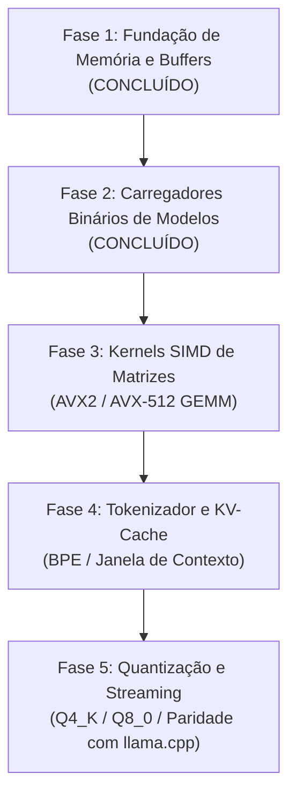

# Roteiro Kaz AI Engine (Arquitetura Revisada)

Este documento estabelece o roteiro técnico, os marcos arquiteturais e os critérios quantitativos de aceitação para o motor de inferência de IA / LLMs nativo integrado à linguagem Kaz.

---

## Estratégia Técnica

O Kaz AI Engine foi projetado para inferência local determinística e de alto desempenho em CPU (x86-64 com extensões AVX2 e AVX-512). O motor se apoia nos buffers contíguos de memória, rotinas freestanding de runtime (`libkazrt`), alocações alinhadas a 64 bytes para SIMD e compilação nativa AOT sem sobrecarga de máquina virtual.

### Linha de Base (Benchmark de Referência)
- **Padrão de Referência**: `llama.cpp` (inferência de referência limpa em C/C++ para CPU).
- **Formatos Quantizados**: GGUF (Q4_K_M, Q8_0) e `.kzm` nativo (Kaz Model).
- **Modelos Alvo**: LLaMA-3, Mistral, Qwen e DeepSeek locais.

---

## Fases e Marcos do Roteiro

---

### Fase 1: Fundação de Memória e Buffers (Concluído)
- **Status**: [x] Concluído
- **Recursos Entregues**:
  - Alocação de memória alinhada a 64 bytes para SIMD (`kaz_alloc`).
  - Proteção de teto ativo de heap contra encerramento pelo OOM-killer do Linux (`heap_set_limit`).
  - Verificação de limites de buffer com tag (`KAZB`, proteção contra estouro aritmético e acessadores Little-Endian seguros).
  - Primitivo `decimal` de ponto fixo de alta precisão com suporte a aritmética de inteiros de 128 bits.
- **Pronto Quando**:
  - Acessos fora dos limites de buffer falham determinísticamente com código de saída 1.
  - Zero regressão de desempenho em operações de laço interno.

---

### Fase 2: Carregadores Binários e Validação de Formatos (Concluído)
- **Status**: [x] Concluído
- **Recursos Entregues**:
  - Implementação de syscalls diretas x86-64 Linux sem dependência de libc (`sys_open_ro`, `sys_lseek`, `sys_mmap`, `sys_munmap`, `sys_close`) em `runtime/kazrt.c`.
  - Primitivos de carregador de modelos binários com zero cópia (`model_open`, `model_close`, `model_size`, `model_type`).
  - Parser e inspeção nativa de formato binário `.kzm` (`kzm_dim`, `kzm_layers`, `kzm_heads`, `kzm_vocab`, `kzm_tensor_count`).
  - Extração direta de ponteiros e tensores (`kzm_tensor_ptr`, `kzm_tensor_size`, `safetensors_tensor_ptr`, `safetensors_tensor_size`).
  - Acesso direto à memória em velocidade de barramento de hardware via `buf_load_f32_le` ignorando alocações e verificações de tag para regiões de `mmap`.
  - Paridade total multiplataforma entre Avaliador AST, Bytecode VM e compilador nativo auto-contido AOT x86-64 sem libc.
- **Pronto Quando**:
  - Arquivos `.kzm` e `.safetensors` válidos ou corrompidos carregam ou falham determinísticamente sem travamentos ou corrupção de memória.
  - Tensores são lidos diretamente de páginas mapeadas sob demanda na largura de banda máxima da RAM.

---

### Fase 3: Kernels Vetoriais SIMD (GEMM / MatMul)
- **Status**: Planejado
- **Objetivos Principais**:
  - Produto escalar vetorizado otimizado em AVX2 / AVX-512 FMA (`vfmadd231ps`).
  - Bloqueio de cache (particionamento em blocos L1/L2) para multiplicação matriz-vetor (`GEMV`).
  - Execução paralela multi-core com pool de threads de baixa sobrecarga.
- **Pronto Quando**:
  - Multiplicação de matrizes FP32 atinge $\ge 85\%$ do rendimento do OpenBLAS em thread única.
  - Escala multi-thread atinge $\ge 3.5\times$ em 4 núcleos físicos.

---

### Fase 4: Tokenizador e KV-Cache
- **Status**: Planejado
- **Objetivos Principais**:
  - Tokenizador rápido Byte-Pair Encoding (BPE) e SentencePiece em código Kaz nativo.
  - KV-Cache em buffer circular para sequências de contexto de até 8K tokens.
  - Kernel de atenção para CPU eficiente em memória (estilo Flash-Attention).
- **Pronto Quando**:
  - Tokenização processa $\ge 500.000\text{ tokens/seg}$.
  - Alocação do KV-cache segue o tamanho exato da sequência sem fragmentação de memória.

---

### Fase 5: Quantização e Inferência Ponta a Ponta
- **Status**: Planejado
- **Objetivos Principais**:
  - Suporte a quantização em blocos: Q4_K_M (pesos de 4 bits) e Q8_0 (pesos de 8 bits).
  - Geração de tokens em streaming com amostragem de temperatura e top-p.
  - Interface CLI `kaz ai run modelo.kzm "prompt"`.
- **Pronto Quando**:
  - Velocidade de geração atinge $\ge 70\%$ dos tokens/segundo do `llama.cpp` no mesmo hardware.
  - Consumo máximo de memória (RSS) permanece estritamente delimitado pelo tamanho do modelo + contexto.
