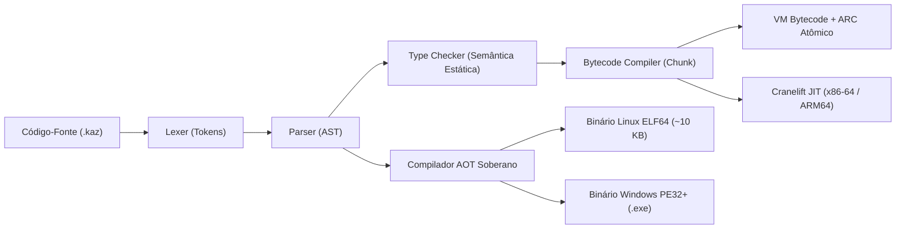
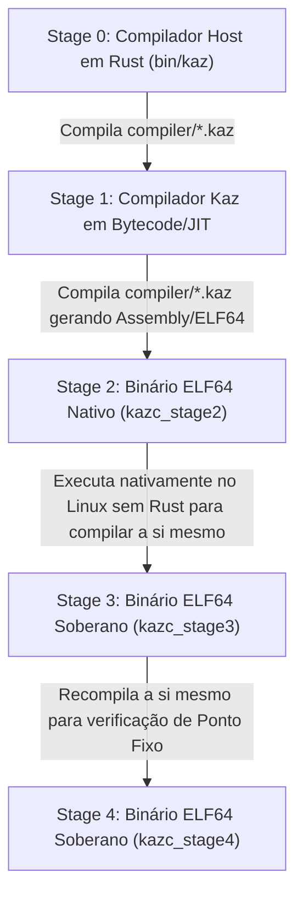

# O Livro Oficial da Linguagem de Programação Kaz (Edição v1.6.0) 🦅

> **O Guia Definitivo e Unificado da Linguagem, Biblioteca Padrão, Compilador AOT Soberano (ELF64 / PE32+) e Motor Nativo de IA (`.kzm`)**
>
> **Versão:** `1.6.0` (Outubro de 2026)  
> **Autor & Criador:** Armando Soares ([@armandosds](https://github.com/armandosds))  
> **Organização:** [Kaz Programming Language (@kazlang)](https://github.com/kazlang)  
> **Website Oficial:** [https://kazlang.xyz](https://kazlang.xyz)  
> **English Edition:** [THE_KAZ_BOOK.md](THE_KAZ_BOOK.md)

---

## Sumário

1. [Capítulo 1: Filosofia, Visão Geral e Instalação](#capítulo-1-filosofia-visão-geral-e-instalação)
2. [Capítulo 2: Fundamentos da Linguagem e Sistema de Tipos](#capítulo-2-fundamentos-da-linguagem-e-sistema-de-tipos)
3. [Capítulo 3: Controle de Fluxo, Funções e Closures](#capítulo-3-controle-de-fluxo-funções-e-closures)
4. [Capítulo 4: Estruturas de Dados, Structs, Interfaces e Módulos](#capítulo-4-estruturas-de-dados-structs-interfaces-e-módulos)
5. [Capítulo 5: Tratamento de Erros (`try`/`catch`), Tagged Unions e Pattern Matching](#capítulo-5-tratamento-de-erros-trycatch-tagged-unions-e-pattern-matching)
6. [Capítulo 6: A Biblioteca Padrão Completa (14 Módulos Nativos)](#capítulo-6-a-biblioteca-padrão-completa-14-módulos-nativos)
7. [Capítulo 7: Ferramental CLI (`kaz`), Gerenciador de Pacotes e Testes](#capítulo-7-ferramental-cli-kaz-gerenciador-de-pacotes-e-testes)
8. [Capítulo 8: Arquitetura de Execução — VM Bytecode e Motor Cranelift JIT](#capítulo-8-arquitetura-de-execução--vm-bytecode-e-motor-cranelift-jit)
9. [Capítulo 9: Compilação AOT Soberana — Emissores Diretos Linux ELF64 e Windows PE32+](#capítulo-9-compilação-aot-soberana--emissores-diretos-linux-elf64-e-windows-pe32)
10. [Capítulo 10: O Compilador Self-Hosted e a Prova de Ponto Fixo (Stage 3 == Stage 4)](#capítulo-10-o-compilador-self-hosted-e-a-prova-de-ponto-fixo-stage-3--stage-4)
11. [Capítulo 11: Gerenciamento de Memória — ARC Atômico e Checkpoints de Heap Soberanos](#capítulo-11-gerenciamento-de-memória--arc-atômico-e-checkpoints-de-heap-soberanos)
12. [Capítulo 12: IA Soberana — Formato Binário `.kzm`, Compilador AOT de 7 Fases e Inferência SIMD AVX2](#capítulo-12-ia-soberana--formato-binário-kzm-compilador-aot-de-7-fases-e-inferência-simd-avx2)

---

## Capítulo 1: Filosofia, Visão Geral e Instalação

### 1.1 Por que a Linguagem Kaz Existe?

**Kaz** é uma linguagem de programação moderna, estaticamente tipada e compilada, projetada do zero sobre três pilares inegociáveis:

1. **Clareza Expressiva sem Custo de Abstração:** A sintaxe de Kaz é limpa, familiar e explícita. Todo tipo, retorno e fluxo de erro é visível no código-fonte, eliminando conversões implícitas silenciosas.
2. **Soberania Total de Toolchain:** Diferente de linguagens que dependem de toolchains externos gigantescos (LLVM, GCC, MSVC, GNU `ld` ou `libc`), o compilador nativo **Ahead-of-Time (AOT)** da Kaz é escrito na própria linguagem Kaz e emite código de máquina `x86-64` diretamente para executáveis **Linux ELF64** e **Windows PE32+ (`.exe`)** com zero assemblers ou linkers externos.
3. **Inferência Nativa de IA de Primeira Classe:** Kaz 1.6.0 incorpora um motor nativo de inferência de Modelos de Linguagem (LLMs) diretamente em seu runtime e biblioteca padrão (`model`), com formato binário proprietário de carregamento zero-RAM via `mmap` (`.kzm`), quantização não-linear em blocos (**KZQ4** / **KZQ8**) e kernels matriciais **AVX2 + FMA3** paralelizados.

### 1.2 Os Três Motores de Execução da Kaz 1.6.0

Um mesmo arquivo-fonte `.kaz` pode ser executado ou compilado por três pipelines complementares:

| Modo de Execução | Comando | Tecnologia Base | Caso de Uso Ideal |
| :--- | :--- | :--- | :--- |
| **VM Bytecode** | `kaz run app.kaz --no-jit` | Máquina Virtual de Pilha em Rust + ARC Atômico | Depuração determinística, portabilidade universal e introspecção |
| **Cranelift JIT** | `kaz run app.kaz` | Compilação Just-In-Time para código de máquina nativo | Desenvolvimento rápido, scripts, servidores web e inferência `.kzm` |
| **AOT Soberano x86-64** | `kaz build app.kaz --target linux\|windows` | Emissor direto de bytes de máquina ELF64 / PE32+ (Self-Hosted) | Binários estáticos de produção (~10 KB), zero dependências externas |

### 1.3 Instalação Rápida

#### Linux e macOS (Script Oficial)
```bash
curl -fsSL https://kazlang.xyz/install.sh | sh
```

#### Windows (PowerShell ou Winget)
```powershell
irm https://kazlang.xyz/install.ps1 | iex
# Ou via Windows Package Manager:
winget install Kazlang.Kaz
```

#### Compilando a partir do Código-Fonte
```bash
git clone https://github.com/kazlang/kaz.git
cd kaz
cargo build --release
export PATH="$PWD/target/release:$PATH"
kaz --version
```

### 1.4 Seu Primeiro Programa em Kaz

Crie um arquivo chamado `ola.kaz`:

```kaz
// ola.kaz — Primeiro programa em Kaz 1.6.0
string linguagem = "Kaz";
string versao = "1.6.0";

runoff("Bem-vindo à linguagem " + linguagem + " v" + versao + "! 🦅");
```

Execute instantaneamente com o motor JIT ou compile para um executável nativo independente:

```bash
# Execução imediata (VM + Cranelift JIT)
kaz run ola.kaz

# Compilação AOT Soberana para binário estático ELF64 (~10 KB)
kaz build ola.kaz -o ola
./ola
```

---

## Capítulo 2: Fundamentos da Linguagem e Sistema de Tipos

### 2.1 Declaração de Variáveis e Constantes

Kaz exige que o tipo de toda variável seja declarado explicitamente (ou inferido de forma estrita via `var` a partir do literal inicializador). Uma variável nunca pode mudar de tipo após sua declaração.

```kaz
// Tipos explícitos (recomendado)
int contador = 42;
float pi = 3.141592653589793;
decimal saldo_bancario = 1500.75d;
bool ativo = true;
string nome = "Armando";

// Inferência estática estrita via 'var'
var porta = 8080;          // Inferido estaticamente como 'int'
var host = "127.0.0.1";    // Inferido estaticamente como 'string'

// Constantes imutáveis em tempo de compilação
const int MAX_CONEXOES = 1024;
const string AMBIENTE = "producao";
```

### 2.2 Tipos Primitivos

| Tipo | Representação Interna | Tamanho | Descrição e Exemplo |
| :--- | :--- | :--- | :--- |
| `int` | Inteiro com sinal (`i64`) | 64 bits | Aritmética inteira exata: `100`, `-42`, `0` |
| `float` | Ponto flutuante IEEE 754 (`f64`) | 64 bits | Computação científica e gráfica: `3.14159`, `-0.001` |
| `decimal` | Ponto fixo de 128 bits (escala $10^8$) | 128 bits | Cálculos financeiros exatos sem erro binário: `19.99d`, `0.1d + 0.2d == 0.3d` |
| `bool` | Booleano lógico | 8 bits | Valores lógicos `true` e `false` |
| `string` | Texto UTF-8 imutável (ARC) | Dinâmico | Cadeias de caracteres Unicode: `"Kaz 🦅"` |
| `bytes` | Buffer binário bruto (`Vec<u8>`) | Dinâmico | Manipulação de arquivos binários, pacotes de rede e pesos de IA |
| `void` | Ausência de valor | 0 bits | Tipo de retorno de funções que não retornam valor |

> [!IMPORTANT]
> **Por que o tipo `decimal` é nativo em Kaz?**  
> Em IEEE 754 (`float`), `0.1 + 0.2` resulta em `0.30000000000000004`. Em Kaz, literais terminados com o sufixo `d` usam aritmética de ponto fixo de 128 bits com 8 casas decimais exatas:
> ```kaz
> decimal preco = 0.1d + 0.2d;
> runoff(preco == 0.3d); // true (exatidão financeira garantida)
> ```

### 2.3 Operadores Aritméticos, Relacionais, Lógicos e Bitwise

```kaz
// Aritméticos
int soma = 10 + 5;       // 15
int sub  = 10 - 5;       // 5
int mult = 10 * 5;       // 50
int div  = 10 / 3;       // 3 (divisão inteira entre ints)
int mod  = 10 % 3;       // 1 (resto da divisão)

// Atribuição composta e incremento
soma += 10;
soma -= 2;
soma++;
soma--;

// Relacionais: ==, !=, <, <=, >, >=
bool maior = (soma > 20);

// Lógicos (com avaliação em curto-circuito): &&, ||, !
bool autorizado = (maior && ativo) || !bloqueado;

// Bitwise (Operações bit a bit em inteiros de 64 bits)
int mascara = (1 << 8) | 0xFF;
int bit_and = mascara & 0x0F;
int bit_xor = mascara ^ 0xFF;
int shift_dir = mascara >> 2;
```

### 2.4 Conversão Explícita de Tipos (Type Casting)

Kaz não realiza coerções numéricas implícitas silenciosas. Use as funções nativas de conversão:

- `int(valor)`: Converte `float`, `decimal`, `string` ou `bool` para `int`.
- `float(valor)`: Converte `int`, `decimal` ou `string` para `float`.
- `decimal(valor)`: Converte `int`, `float` ou `string` para `decimal`.
- `str(valor)`: Converte qualquer valor primitivo ou composto para sua representação textual `string`.

### 2.5 Saída Padrão (`runoff`) e Entrada (`input`)

A palavra-chave nativa `runoff(...)` imprime qualquer expressão na saída padrão seguida de quebra de linha:

```kaz
runoff("Resultado:", 42);
string nome_usuario = input("Digite seu nome: ");
runoff("Olá, " + nome_usuario + "!");
```

---

## Capítulo 3: Controle de Fluxo, Funções e Closures

### 3.1 Condicionais (`if` / `else if` / `else`)

A condição de um bloco `if` deve obrigatoriamente resultar em um `bool` (números ou strings não são avaliados implicitamente como booleanos):

```kaz
int nota = 85;

if (nota >= 90) {
    runoff("Conceito A — Excelente");
} else if (nota >= 70) {
    runoff("Conceito B — Aprovado");
} else {
    runoff("Conceito C — Em recuperação");
}
```

### 3.2 Laços de Repetição (`while`, `for`, `for..in`, `break`, `continue`)

```kaz
// 1. Laço while clássico
int n = 5;
while (n > 0) {
    runoff("Contagem:", n);
    n--;
}

// 2. Laço for estilo C
for (int i = 0; i < 10; i++) {
    if (i % 2 == 0) {
        continue; // Pula números pares
    }
    if (i > 7) {
        break;    // Interrompe o laço
    }
    runoff("Ímpar:", i);
}

// 3. Laço for..in sobre listas (Arrays)
string[] linguagens = ["Kaz", "Rust", "C"];
for (lang in linguagens) {
    runoff("Linguagem:", lang);
}
```

### 3.3 Declaração de Funções e Recursão

Funções são declaradas com a palavra-chave `func`, parâmetros tipados e tipo de retorno explícito após `->`:

```kaz
func fatorial(int n) -> int {
    if (n <= 1) {
        return 1;
    }
    return n * fatorial(n - 1);
}

func saudar(string nome) -> void {
    runoff("Bem-vindo(a), " + nome + "!");
}

runoff("5! =", fatorial(5)); // 120
saudar("Comunidade Kaz");
```

### 3.4 Funções de Primeira Classe, Lambdas e Closures

Em Kaz, funções são valores de primeira classe: podem ser armazenadas em variáveis, passadas como argumentos e retornadas por outras funções, capturando variáveis do escopo léxico externo (**Closures** via `Upvalue` na VM):

```kaz
func criar_multiplicador(int fator) -> any {
    return func(int valor) -> int {
        return valor * fator; // Captura 'fator' do escopo externo
    };
}

var triplicar = criar_multiplicador(3);
runoff(triplicar(14)); // 42
```

---

## Capítulo 4: Estruturas de Dados, Structs, Interfaces e Módulos

### 4.1 Arrays (Listas Dinâmicas Tipadas)

Arrays em Kaz são homogêneos, redimensionáveis dinamicamente e verificados contra acesso fora dos limites em tempo de execução:

```kaz
int[] numeros = [10, 20, 30];

// Adicionando elementos ao final
push(numeros, 40);
push(numeros, 50);

// Acesso e modificação por índice (base 0)
runoff("Primeiro:", numeros[0]); // 10
numeros[1] = 25;

// Tamanho e remoção do último elemento
runoff("Total de elementos:", len(numeros)); // 5
int ultimo = pop(numeros);                   // 50
```

### 4.2 Mapas (Dicionários / Hash Maps)

Mapas associam chaves `string` a valores dinamicamente:

```kaz
map configuracao = {
    "host": "0.0.0.0",
    "porta": 8080,
    "tls": true
};

// Leitura e escrita de chaves
runoff("Servidor em:", configuracao["host"], "porta:", configuracao["porta"]);
configuracao["workers"] = 8;

// Introspecção de chaves
if (has_key(configuracao, "tls")) {
    string[] todas_chaves = keys(configuracao);
    runoff("Total de chaves:", len(todas_chaves));
}
```

### 4.3 `struct` e Métodos Associados (`impl`)

Structs definem tipos compostos com layout de campos estático e métodos associados via blocos `impl`:

```kaz
struct Vetor3D {
    float x;
    float y;
    float z;
}

impl Vetor3D {
    func norma_quadrada(Vetor3D self) -> float {
        return (self.x * self.x) + (self.y * self.y) + (self.z * self.z);
    }

    func escalar(Vetor3D self, float k) -> Vetor3D {
        return Vetor3D {
            x: self.x * k,
            y: self.y * k,
            z: self.z * k
        };
    }
}

Vetor3D v = Vetor3D { x: 1.0, y: 2.0, z: 2.0 };
runoff("Norma ao quadrado:", v.norma_quadrada()); // 9.0
```

### 4.4 `interface` e Contratos Polimórficos

Interfaces estabelecem contratos estáticos de métodos que uma `struct` deve implementar:

```kaz
interface Serializavel {
    func para_json(any self) -> string;
}
```

### 4.5 Sistema de Módulos (`import` / `export`)

Kaz resolve módulos de forma determinística com cache de AST e detecção de dependências cíclicas:

```kaz
// Em matematica/geometria.kaz
export func area_circulo(float raio) -> float {
    return 3.141592653589793 * raio * raio;
}

// Em main.kaz
import "matematica/geometria.kaz";
import "math";   // Módulo nativo da Biblioteca Padrão
import "crypto"; // Módulo nativo de criptografia

runoff("Área:", area_circulo(5.0));
```

---

## Capítulo 5: Tratamento de Erros (`try`/`catch`), Tagged Unions e Pattern Matching

### 5.1 Tratamento Estruturado de Exceções (`try` / `catch` / `throw`)

Kaz possui suporte nativo a **stack unwinding** (desempilhamento seguro de frames de execução) tanto para erros internos da VM (como divisão por zero ou falha de I/O) quanto para exceções lançadas pelo desenvolvedor com `throw`:

```kaz
func transferir_fundos(decimal saldo, decimal valor) -> decimal {
    if (valor <= 0.0d) {
        throw "O valor da transferência deve ser positivo.";
    }
    if (valor > saldo) {
        throw "Saldo insuficiente para realizar a operação.";
    }
    return saldo - valor;
}

try {
    decimal novo_saldo = transferir_fundos(100.00d, 250.00d);
    runoff("Novo saldo:", novo_saldo);
} catch (erro) {
    runoff("[ALERTA DE TRANSAÇÃO] Operação abortada:", erro);
}
```

Quando uma instrução `throw` (ou falha de runtime) ocorre:
1. O runtime consulta a pilha de handlers `TryFrame` registrados pelo opcode `OpSetupTry`.
2. A pilha de chamadas (`CallFrame`) e a pilha de valores são restauradas instantaneamente para a profundidade exata do bloco `try`, liberando referências ARC intermediárias sem vazamento de memória.
3. A mensagem de erro é injetada na variável do bloco `catch (erro)` e a execução prossegue com segurança.

### 5.2 Enumerações e Tagged Unions (`enum`)

Além de enumerações simples, Kaz suporta **Tipos Algébricos de Dados (Tagged Unions)** — enums cujas variantes podem carregar payloads tipados:

```kaz
enum ResultadoHttp {
    Sucesso(int, string),
    Redirecionamento(string),
    ErroConexao(string),
    Timeout
}
```

### 5.3 Pattern Matching Exaustivo (`match`)

A construção `match` permite desestruturar valores primitivos, enums e Tagged Unions com clareza total:

```kaz
func processar_resposta(ResultadoHttp resp) -> void {
    match (resp) {
        ResultadoHttp::Sucesso(status, corpo) => {
            runoff("HTTP", status, "-> Recebido:", len(corpo), "bytes");
        },
        ResultadoHttp::Redirecionamento(nova_url) => {
            runoff("Redirecionando para:", nova_url);
        },
        ResultadoHttp::ErroConexao(motivo) => {
            runoff("Falha de rede:", motivo);
        },
        ResultadoHttp::Timeout => {
            runoff("A requisição excedeu o tempo limite.");
        }
    }
}
```

---

## Capítulo 6: A Biblioteca Padrão Completa (14 Módulos Nativos)

A Biblioteca Padrão da Kaz 1.6.0 é compilada diretamente no binário da linguagem em Rust de alta performance, oferecendo **14 módulos nativos** prontos para uso sem instalar pacotes externos.

### 6.1 Funções Globais (Core Prelude — Sempre Disponíveis)

| Função | Assinatura | Descrição |
| :--- | :--- | :--- |
| `runoff(...)` | `(any...) -> void` | Imprime um ou mais valores no `stdout` com quebra de linha |
| `input(prompt)` | `(string) -> string` | Exibe `prompt` e lê uma linha do `stdin` |
| `len(colecao)` | `(string\|array\|map\|bytes) -> int` | Retorna o comprimento de strings, arrays, mapas ou buffers |
| `push(arr, item)` | `(T[], T) -> void` | Insere `item` no final do array `arr` |
| `pop(arr)` | `(T[]) -> T` | Remove e retorna o último elemento do array `arr` |
| `keys(mapa)` | `(map) -> string[]` | Retorna uma lista com todas as chaves do mapa |
| `has_key(mapa, k)` | `(map, string) -> bool` | Verifica se a chave `k` existe no mapa |
| `typeof(valor)` | `(any) -> string` | Retorna o nome do tipo em runtime (`"int"`, `"decimal"`, etc.) |
| `assert(cond, msg)` | `(bool, string) -> void` | Interrompe a execução com erro se `cond` for `false` |
| `ord(caractere)` | `(string) -> int` | Retorna o código ASCII/Unicode do primeiro byte/caractere |
| `chr(codigo)` | `(int) -> string` | Converte um código inteiro em seu caractere correspondente |

### 6.2 Módulo `io` e Sistema de Arquivos (`fs`)

```kaz
import "io";

// Escrita e leitura textual
write_file("relatorio.txt", "Kaz 1.6.0 em produção\n");
append_file("relatorio.txt", "Segunda linha do log\n");

if (file_exists("relatorio.txt")) {
    string conteudo = read_file("relatorio.txt");
    runoff(conteudo);
}

// Manipulação de diretórios e binários brutos (bytes)
mkdir("dados_binarios");
string[] arquivos = list_dir(".");
bytes raw = read_bytes("relatorio.txt");
write_bytes("dados_binarios/copia.bin", raw);
```

### 6.3 Módulo `str` (Processamento de Strings)

```kaz
import "str";

string texto = "  Kaz 1.6.0: Compilador AOT Soberano  ";
string limpo = trim(texto);
string maiusculo = to_upper(limpo);
string minusculo = to_lower(limpo);

bool contem_aot = contains(limpo, "AOT");            // true
bool inicia_kaz = starts_with(limpo, "Kaz");         // true
string trocado  = replace(limpo, "1.6.0", "Soberano");
string[] partes = split(limpo, " ");
string unido    = join(partes, "-");
string fatia    = substring(limpo, 0, 9);            // "Kaz 1.6.0"
int posicao     = index_of(limpo, "AOT");
```

### 6.4 Módulo `math` (Matemática Científica e Ponto Flutuante)

```kaz
import "math";

float r = sqrt(144.0);          // 12.0
float p = pow(2.0, 10.0);       // 1024.0
float s = sin(3.14159265 / 2.0);
float c = cos(0.0);
float l = log(2.718281828);
int arredondado = round(3.7);   // 4
int piso = floor(3.9);          // 3
int teto = ceil(3.1);           // 4
int absoluto = abs(-99);        // 99
```

### 6.5 Módulo `time` (Relógio de Alta Precisão e Timers)

```kaz
import "time";

int inicio_ms = now_ms();       // Timestamp Unix em milissegundos
int inicio_ns = now_ns();       // Timestamp de alta resolução em nanossegundos
sleep_ms(50);                   // Pausa a thread atual por 50 ms
int decorrido = now_ms() - inicio_ms;
runoff("Tempo decorrido:", decorrido, "ms");
```

### 6.6 Módulo `os` (Sistema Operacional, Processos e Memória Soberana)

```kaz
import "os";

string[] argumentos = args();           // Argumentos de linha de comando (CLI)
string diretorio_atual = cwd();         // Diretório de trabalho atual
string home = env_get("HOME");          // Leitura de variável de ambiente
string plataforma = platform();         // "linux", "windows" ou "macos"

// Execução de comandos do sistema
map resultado = exec("uname -a");
runoff("Saída:", resultado["stdout"]);

// Gerenciamento Soberano de Heap (Checkpoints de Memória Constante)
int marca = heap_checkpoint();
// ... alocações temporárias pesadas ...
heap_rewind(marca); // Libera instantaneamente em O(1) tudo alocado após 'marca'
```

### 6.7 Módulo `json` (Serialização e Parsing JSON)

```kaz
import "json";

map usuario = {
    "id": 1,
    "nome": "Armando",
    "linguagem": "Kaz",
    "ativo": true
};

string payload_json = json_stringify(usuario);
runoff("JSON serializado:", payload_json);

map objeto_recuperado = json_parse(payload_json);
runoff("Nome recuperado:", objeto_recuperado["nome"]);
```

### 6.8 Módulo `crypto` (Criptografia de Nível Militar e Hashing)

```kaz
import "crypto";

// Hashes criptográficos SHA-256 e SHA-512
string hash256 = sha256("Kaz 1.6.0 Soberano");
string hash512 = sha512("Kaz 1.6.0 Soberano");

// Autenticação de mensagens HMAC-SHA256
string assinatura = hmac_sha256("chave-secreta", "mensagem-autenticada");

// Criptografia autenticada simétrica AES-256-GCM e geração de UUID v4
string id_unico = uuid_v4();
string token_aleatorio = random_hex(32);
string base64_codificado = base64_encode("Dados sensíveis");
string base64_decodificado = base64_decode(base64_codificado);
```

### 6.9 Módulo `http` e `net` (Cliente/Servidor HTTP e Sockets TCP)

```kaz
import "http";

// Cliente HTTP/HTTPS nativo
map resposta = http_get("https://kazlang.xyz");
runoff("Status HTTP:", resposta["status"]);

// Servidor HTTP nativo em poucas linhas
func tratador(map req) -> map {
    return {
        "status": 200,
        "content_type": "application/json",
        "body": "{\"status\":\"online\",\"engine\":\"Kaz 1.6.0\"}"
    };
}
// http_serve("127.0.0.1:8080", tratador);
```

### 6.10 Módulo `db` (Banco de Dados Relacional SQLite Embarcado)

```kaz
import "db";

int conexao = db_open("aplicacao.db");
db_exec(conexao, "CREATE TABLE IF NOT EXISTS usuarios (id INTEGER PRIMARY KEY, nome TEXT, saldo REAL);");
db_exec(conexao, "INSERT INTO usuarios (nome, saldo) VALUES ('Armando', 1500.75);");

map[] linhas = db_query(conexao, "SELECT id, nome, saldo FROM usuarios;");
for (linha in linhas) {
    runoff("Usuário:", linha["nome"], "| Saldo:", linha["saldo"]);
}
db_close(conexao);
```

### 6.11 Módulo `regex` (Expressões Regulares)

```kaz
import "regex";

bool email_valido = regex_match("^[a-zA-Z0-9._%+-]+@[a-zA-Z0-9.-]+\\.[a-zA-Z]{2,}$", "contato@kazlang.xyz");
string[] numeros_extraidos = regex_find_all("[0-9]+", "Kaz 1.6.0 compila em 12 ms com 6485x de ganho");
string censurado = regex_replace("[0-9]+", "Senha12345", "***");
```

### 6.12 Módulo `async` (Concorrência, Threads, Canais e Mutex)

```kaz
import "async";

// Canais tipados thread-safe (MPSC) para troca de mensagens entre threads
int canal = channel_create();

spawn(func() -> void {
    channel_send(canal, "Tarefa concluída em thread paralela!");
});

string msg = channel_recv(canal);
runoff(msg);
```

### 6.13 Módulo `ffi` (Foreign Function Interface — Interoperabilidade C ABI)

Permite carregar bibliotecas dinâmicas do sistema (`.so` no Linux, `.dll` no Windows, `.dylib` no macOS) e invocar símbolos da ABI C diretamente:

```kaz
import "ffi";

int libc = ffi_open("libc.so.6");
int pid = ffi_call_int(libc, "getpid");
runoff("PID do processo via FFI:", pid);
```

### 6.14 Módulo `model` (Motor Nativo de Inferência de IA e Tensores `.kzm`)

Documentado em profundidade no **Capítulo 12**, o módulo `model` expõe carregamento `mmap` zero-RAM de modelos `.kzm`, tokenização BPE nativa, RMSNorm, RoPE, GQA Attention com KV-Cache persistente e multiplicação matriz-vetor quantizada KZQ4/KZQ8 acelerada por AVX2.

---

## Capítulo 7: Ferramental CLI (`kaz`), Gerenciador de Pacotes e Testes

O binário `kaz` unifica todas as ferramentas necessárias para o ciclo de vida completo de desenvolvimento em um único executável:

```text
USO:
    kaz <SUBCOMANDO> [OPÇÕES] [ARQUIVO]

SUBCOMANDOS PRINCIPAIS:
    run <arquivo.kaz>          Executa um programa Kaz (Cranelift JIT ativo por padrão)
    build <arquivo.kaz>        Compila para binário nativo AOT (Linux ELF64 ou Windows PE32+)
    check <arquivo.kaz>        Executa análise léxica, sintática e semântica sem rodar o código
    test [diretório|arquivo]   Descobre e executa suítes de testes automatizados (*_test.kaz)
    fmt [diretório|arquivo]    Formata o código-fonte seguindo o estilo canônico da Kaz
    repl                       Inicia o console interativo (Read-Eval-Print Loop)
    disasm <arquivo.kaz>       Desmonta e exibe o bytecode gerado pela VM e constantes
    doc <arquivo.kaz>          Extrai comentários de documentação e gera referência em Markdown/HTML
    lsp                        Inicia o servidor Language Server Protocol (IDE / VS Code / TermiKAZ)
    init [nome]                Inicializa um novo projeto Kaz com manifesto kaz.toml
    pkg <install|list|publish> Gerenciador oficial de pacotes e dependências
```

### 7.1 Anatomia de um Projeto Kaz (`kaz init`)

Ao executar `kaz init meu_servico`, a seguinte estrutura padronizada é criada:

```text
meu_servico/
├── kaz.toml          # Manifesto do projeto, versão, autor e dependências
├── src/
│   └── main.kaz      # Ponto de entrada principal da aplicação
└── tests/
    └── main_test.kaz # Suíte de testes unitários automatizados
```

Exemplo de arquivo `kaz.toml`:

```toml
[package]
name = "meu_servico"
version = "1.6.0"
authors = ["Armando Soares <contato@kazlang.xyz>"]
edition = "2026"

[dependencies]
```

### 7.2 Escrevendo e Executando Testes (`kaz test`)

O runner de testes integrado descobre e executa arquivos `*_test.kaz` com medição de tempo em milissegundos:

```kaz
// tests/matematica_test.kaz
func somar(int a, int b) -> int {
    return a + b;
}

assert(somar(20, 22) == 42, "A soma de 20 + 22 deve ser exatamente 42");
assert(0.1d + 0.2d == 0.3d, "Aritmética decimal de 128 bits deve ser exata");
runoff("✅ Todos os testes de matemática passaram!");
```

Execute com:
```bash
kaz test tests/matematica_test.kaz
```

---

## Capítulo 8: Arquitetura de Execução — VM Bytecode e Motor Cranelift JIT

### 8.1 Pipeline Completo do Compilador Host



1. **Lexer (`src/lexer.rs` / `compiler/frontend/lexer.kaz`):** Transforma o fluxo de caracteres UTF-8 em tokens posicionados com linha e coluna exatas, reconhecendo literais `int`, `float`, `decimal` (sufixo `d`), strings interpoladas e operadores compostos.
2. **Parser (`src/parser.rs` / `compiler/frontend/parser.kaz`):** Constrói a Árvore Sintática Abstrata (AST) usando descida recursiva e precedência de operadores (Pratt Parsing).
3. **Type Checker (`src/typechecker.rs` / `compiler/sema/typechecker.kaz`):** Valida tipos estaticamente antes de qualquer execução: verifica assinaturas de funções, exaustividade de tipos em `struct` e `enum`, imutabilidade de `const` e visibilidade de módulos.
4. **Bytecode Compiler (`src/compiler.rs`):** Emite instruções compactas de pilha (`OpCode`) agrupadas em `Chunk`s com tabela de constantes deduplicadas.

### 8.2 Conjunto de Instruções da Máquina Virtual (`src/vm.rs`)

A VM da Kaz utiliza representação **NaN-Boxed / Tagged Value** de alta densidade para primitivos e ponteiros `Arc<T>` para estruturas alocadas no heap:

- **Aritmética Tipada e Rápida:** `OpAdd`, `OpSub`, `OpMul`, `OpDiv`, `OpMod`, `OpNeg` com caminhos rápidos (*fast-paths*) para `int`, `float` e `decimal`.
- **Controle de Fluxo e Chamadas:** `OpJump`, `OpJumpIfFalse`, `OpLoop`, `OpCall`, `OpClosure`, `OpGetUpvalue`, `OpSetUpvalue`, `OpCloseUpvalue`, `OpReturn`.
- **Exceções Estruturadas:** `OpSetupTry(offset)`, `OpPopTry`, `OpThrow` com restauração determinística de `CallFrame` e pilha de operandos.
- **Introspecção de Bytecode:** Use `kaz disasm arquivo.kaz` para inspecionar cada instrução gerada pelo compilador.

### 8.3 O Motor Cranelift JIT (`src/jit.rs`)

Quando executado no modo padrão (`kaz run`), o motor **Cranelift JIT** identifica funções críticas computacionais e traduz a AST/Bytecode diretamente para instruções de máquina nativas da arquitetura hospedeira (`x86-64` ou `AArch64`) em memória executável, reduzindo o overhead de despacho de instruções da VM a zero em loops numéricos intensivos.

---

## Capítulo 9: Compilação AOT Soberana — Emissores Diretos Linux ELF64 e Windows PE32+

### 9.1 O Que Significa "Compilação AOT Soberana"?

Até a versão 1.4, compilar um programa nativo exigia invocar ferramentas externas instaladas no sistema operacional (`nasm` para montar assembly e `ld` para linkar o executável).

Na **Kaz 1.6.0**, o compilador AOT atingiu **Soberania Absoluta**:
- **Zero NASM / Zero GNU `as`:** Os próprios módulos de backend da Kaz codificam os opcodes `x86-64` byte a byte (prefixos `REX.W`, `ModR/M`, `SIB`, deslocamentos `rel32` e imediatos de 64 bits).
- **Zero GNU `ld` / Zero `link.exe`:** Os escritores binários `elf64_writer.kaz` e `pe64_writer.kaz` constroem diretamente os cabeçalhos do sistema operacional, tabelas de seções e tabelas de importação.
- **Zero `libc` no Linux:** Os binários ELF64 comunicam-se diretamente com o kernel Linux via instrução `syscall` (`sys_read = 0`, `sys_write = 1`, `sys_open = 2`, `sys_close = 3`, `sys_brk = 12`, `sys_exit = 60`).

### 9.2 Arquitetura do Emissor Nativo Linux ELF64 (`compiler/backend/elf64/`)

O emissor ELF64 constrói uma imagem executável estática carregada no endereço virtual base `0x400000`:

```text
+-------------------------------------------------------------------+
| ELF64 Header (64 bytes)                                           |
|   e_ident: 7F 45 4C 46 02 01 01 ("ELF" 64-bit LSB)                |
|   e_type: ET_EXEC (2) | e_machine: EM_X86_64 (62)                 |
|   e_entry: Endereço virtual de _start                             |
+-------------------------------------------------------------------+
| Program Header Table (56 bytes — PT_LOAD RX/RWX)                  |
|   p_vaddr: 0x400000 | p_align: 0x1000                             |
+-------------------------------------------------------------------+
| Seção .text (Instruções de Máquina x86-64 + Runtime Syscall Stub) |
+-------------------------------------------------------------------+
| Seção .rodata / .data (Strings Literais e Tabelas Constantes)     |
+-------------------------------------------------------------------+
```

Um binário "Olá Mundo" compilado pela Kaz gera um executável estático de apenas **~10 KB** que roda em qualquer distribuição Linux `x86-64` (mesmo dentro de um container `FROM scratch` vazio).

### 9.3 Arquitetura do Emissor Nativo Windows PE32+ (`compiler/backend/pe64/pe64_writer.kaz`)

Para garantir a mesma soberania no Windows 64 bits sem precisar do Visual Studio Build Tools ou MinGW, o módulo `pe64_writer.kaz` emite executáveis **PE32+ (`.exe`)** completos com **Import Address Table (IAT)** construída manualmente para a `kernel32.dll`:

```text
+-------------------------------------------------------------------+
| DOS Header ("MZ" - 64 bytes) + Offset PE em 0x3C -> 0x40          |
+-------------------------------------------------------------------+
| PE Signature ("PE\0\0") + COFF File Header (Machine: 0x8664 AMD64)|
+-------------------------------------------------------------------+
| Optional Header PE32+ (Magic: 0x020B, ImageBase: 0x00400000)      |
|   Subsystem: IMAGE_SUBSYSTEM_WINDOWS_CUI (3 - Console)            |
|   DataDirectories[1] (Import Table) & DataDirectories[12] (IAT)   |
+-------------------------------------------------------------------+
| Section Table:                                                    |
|   1. .text  (RVA 0x1000) -> Código x86-64 Windows x64 ABI         |
|   2. .idata (RVA 0x2000) -> Import Directory + IAT (kernel32.dll) |
|      - ExitProcess                                                |
|      - GetStdHandle                                               |
|      - WriteFile                                                  |
|   3. .data  (RVA 0x3000) -> Strings literais e buffers globais    |
+-------------------------------------------------------------------+
```

> [!TIP]
> **Compilação Cruzada Soberana (`tools/aot_soberano.kaz`):**  
> Você pode gerar tanto binários Linux ELF64 quanto executáveis Windows `.exe` a partir de qualquer máquina:
> ```bash
> # Gerar executável Linux ELF64
> kaz build app.kaz --target linux -o app_linux
>
> # Gerar executável Windows PE32+ (.exe) diretamente do Linux!
> kaz build app.kaz --target windows -o app.exe
> ```

---

## Capítulo 10: O Compilador Self-Hosted e a Prova de Ponto Fixo (Stage 3 == Stage 4)

### 10.1 A Escada do Bootstrapping (Self-Hosting)

O marco definitivo de maturidade de uma linguagem de programação de sistemas é ser capaz de compilar seu próprio compilador sem ajuda externa. Na Kaz 1.6.0, o compilador auto-hospedado reside em `compiler/` e atravessa os seguintes estágios de bootstrap:



### 10.2 Verificação Matemática de Ponto Fixo (Bit-for-Bit Reproducibility)

Quando o binário nativo **Stage 3** (que já foi gerado sem tocar no compilador Rust) compila o código-fonte do compilador Kaz para produzir o **Stage 4**, os dois executáveis ELF64 resultantes possuem exatamente o mesmo tamanho e o **mesmo hash criptográfico SHA-256 bit a bit**:

```text
SHA-256 (kazc_stage3) == SHA-256 (kazc_stage4)
2562fc06227262d68d855aa8f6bc8c18b453be3ab22edbc8ae3e289b6a8a3501
```

Isso comprova matematicamente:
1. **Autossuficiência Completa:** A linguagem Kaz é 100% capaz de manter e evoluir seu próprio compilador.
2. **Determinismo Absoluto de Geração de Código:** O emissor nativo `x86-64` não depende de estados não-determinísticos de memória ou timestamps externos.

---

## Capítulo 11: Gerenciamento de Memória — ARC Atômico e Checkpoints de Heap Soberanos

Kaz oferece segurança total de memória sem pausas imprevisíveis de Garbage Collectors tradicionais (*Stop-the-World GC*), combinando duas estratégias complementares para a VM/JIT e para o runtime nativo AOT:

### 11.1 ARC Atômico (Automatic Reference Counting) na VM e JIT

Na Máquina Virtual e no runtime JIT, strings, arrays, mapas e closures são gerenciados por ponteiros de contagem de referências atômica (`Arc<T>`):
- **Clonagem em $O(1)$:** Passar uma string de 100 MB ou uma lista gigante para uma função apenas incrementa um contador atômico de 64 bits, sem copiar os bytes subjacentes (*Copy-on-Write* semântico).
- **Liberação Determinística:** Assim que a última variável que referencia um objeto sai de escopo (ou quando a pilha é desempilhada em um `return` ou `catch`), a memória é devolvida imediatamente ao sistema operacional.

### 11.2 Alocador Bump `sys_brk` e Checkpoints de Heap Soberanos (`heap_checkpoint` / `heap_rewind`)

Em compiladores de longa execução, servidores de alta frequência ou loops de inferência de IA token a token, alocar milhões de strings temporárias pode causar fragmentação ou exaustão de memória (DoS).

Para resolver isso de forma determinística, a Kaz 1.6.0 introduziu as primitivas soberanas de região de memória (`Arena Checkpointing`):

- **No Runtime Nativo ELF64 (`sys_brk`):** O runtime mantém um ponteiro de topo de heap (`heap_ptr`) expandido sob demanda via syscall `sys_brk (12)`.
- **`int marca = heap_checkpoint()`:** Captura o cursor exato da arena de alocação no início de uma fase crítica (por exemplo, antes de compilar uma função ou antes de gerar um token no LLM).
- **`heap_rewind(marca)`:** Restaura o ponteiro de heap de volta para `marca` em **tempo constante $O(1)$** (uma única instrução `mov`), reciclando instantaneamente 100% das alocações temporárias daquela iteração.

```kaz
import "os";

// Exemplo: Processamento de 1.000.000 de requisições com consumo de RAM O(1) constante!
for (int req = 0; req < 1000000; req++) {
    int checkpoint = heap_checkpoint();

    // Alocações temporárias intensivas dentro do loop
    string payload = "Requisicao #" + str(req) + " processada com sucesso";
    
    // Recicla toda a memória temporária da iteração em O(1)
    heap_rewind(checkpoint);
}
```

---

## Capítulo 12: IA Soberana — Formato Binário `.kzm`, Compilador AOT de 7 Fases e Inferência SIMD AVX2

A Kaz 1.6.0 é a primeira linguagem de programação de propósito geral projetada com um **motor nativo de inferência de Grandes Modelos de Linguagem (LLMs)** integrado diretamente à sua biblioteca padrão e ao seu compilador AOT.

### 12.1 O Problema dos Formatos Tradicionais de IA

Servir modelos Transformer modernos (como **OLMo-2**, **Llama-3**, **Qwen** ou **Mistral**) em Python/PyTorch exige gigabytes de dependências C++/CUDA e carrega arquivos `.safetensors` inteiros para a memória RAM antes de iniciar a primeira inferência.

A solução da Kaz 1.6.0 é composta por três tecnologias proprietárias:
1. **O Formato Binário `.kzm` (Kaz Model Format v2):** Projetado para mapeamento direto de páginas do kernel (`mmap`) com alinhamento de 64 bytes compatível com registradores SIMD AVX2/AVX-512 e **0 MB de alocação inicial em RAM**.
2. **Quantização Não-Linear em Blocos (`KZQ4` e `KZQ8`):** Reduz modelos `BF16`/`FP32` em até **75%** preservando a acurácia semântica.
3. **O Compilador AOT de Modelos em 7 Fases (`compiler/ai/`):** Escrito em Kaz, lê modelos `.safetensors` e gera arquivos `.kzm` e código AOT especializado para a topologia exata do modelo.

### 12.2 Especificação Binária do Formato `.kzm` (v2)

```text
+=======================================================================+
| 1. HEADER GLOBAL (36 Bytes)                                           |
|    - Magic Bytes (4B): "KZM\0" (0x4B, 0x5A, 0x4D, 0x00)               |
|    - Version (4B u32): 2 (Suporte a Quantização KZQ4/KZQ8)            |
|    - Hyperparameters (7 x 4B u32):                                    |
|      dim, hidden_dim, n_layers, n_heads, n_kv_heads, vocab_size,      |
|      max_seq_len                                                      |
+=======================================================================+
| 2. METADADOS & TOKENIZADOR BPE EMBARCADO                              |
|    - JSON de Arquitetura (rope_theta, rms_norm_eps, tie_embeddings)   |
|    - Tabela de Vocabulário BPE (vocab_size entradas UTF-8 + scores)   |
+=======================================================================+
| 3. DIRETÓRIO DE TENSORES (Tensor Index Table)                         |
|    - Nome do Tensor | Shape | Dtype (0=F32, 1=KZQ8, 2=KZQ4)           |
|    - Offset Absoluto de 64 bits no arquivo | Tamanho em Bytes         |
+=======================================================================+
| 4. BLOCO DE DADOS ALINHADO (64-Byte Cache-Line Aligned Payload)       |
|    - Mapeado diretamente na memória virtual via mmap() sob demanda    |
+=======================================================================+
```

#### Estrutura dos Blocos de Quantização `KZQ4` e `KZQ8`

- **`KZQ8` (8-bit Block Quantization — 36 bytes por bloco de 32 pesos):**
  - `scale` (`f32`, 4 bytes): $\text{scale} = \frac{\max(|W_i|)}{127.0}$
  - `quants` (`32 x i8`, 32 bytes): $q_i = \text{round}(W_i / \text{scale}) \in [-127, 127]$
- **`KZQ4` (4-bit Symmetric Block Quantization — 20 bytes por bloco de 32 pesos):**
  - `scale` (`f32`, 4 bytes): $\text{scale} = \frac{\max(|W_i|)}{7.0}$
  - `nibbles` (`16 x u8`, 16 bytes): Dois pesos de 4 bits empacotados por byte (nibble baixo $q_{2k} + 8$, nibble alto $q_{2k+1} + 8$).
  - **Taxa de Compressão:** De 128 bytes (`32 x f32`) para **20 bytes** (**6,4x menor que FP32** e **3,2x menor que BF16**).

### 12.3 O Compilador AOT de Modelos de IA em 7 Fases (`compiler/ai/`)

Localizado em `compiler/ai/`, o pipeline transforma pesos brutos em motores de inferência otimizados através de 7 fases modulares:

| Fase | Arquivo | Responsabilidade Técnica |
| :--- | :--- | :--- |
| **Fase 1** | `phase1_ingest.kaz` | Ingestão binária de `.safetensors`, validação do cabeçalho JSON de 64 bits e extração do catálogo de tensores |
| **Fase 2** | `phase2_graph.kaz` | Construção do Grafo Computacional Estático (DAG) e inferência automática da topologia (`n_layers`, `dim`, `n_heads`, `n_kv_heads`) |
| **Fase 3** | `phase3_fusion.kaz` | Fusão de Operadores (*Operator Fusion*): funde `RMSNorm + Linear` e blocos `SwiGLU (Gate + Up + SiLU)` para eliminar leituras intermediárias de RAM |
| **Fase 4** | `phase4_memory_plan.kaz` | Planejamento Estático de Arena de Memória: calcula offsets exatos de `KV-Cache` e buffers de ativação com **zero `malloc` durante o decode** |
| **Fase 5** | `phase5_quantize.kaz` | Calibração de escala por bloco de 32 pesos, empacotamento nibble-a-nibble `KZQ4`/`KZQ8` e alinhamento de páginas de 64 bytes |
| **Fase 6** | `phase6_codegen.kaz` | Geração de Código Nativo AOT (`x86-64` AVX2 + FMA3) com loops desenrolados (*loop unrolling*) para as dimensões exatas das camadas do modelo |
| **Fase 7** | `phase7_kzm_export.kaz` | Empacotamento soberano do artefato final `.kzm` com verificação de integridade estrutural |

### 12.4 Usando o Módulo `model` para Inferência de LLMs em Kaz

```kaz
import "model";

// 1. Carrega o modelo OLMo-2-1B quantizado em KZQ4 via mmap (0 MB de cópia em RAM, < 5 ms)
int m = model_load("models/olmo-2-1b-kzq4.kzm");

// 2. Tokeniza o prompt usando o vocabulário BPE embarcado no próprio arquivo .kzm
int[] tokens = model_tokenize(m, "Explique a arquitetura do compilador Kaz:");

// 3. Aloca o estado persistente de KV-Cache para atenção autoregressiva O(1) por token
int kv = kv_cache_create(m);

// 4. Loop de geração de tokens (Prefill + Decode acelerado por AVX2)
int pos = 0;
for (int i = 0; i < len(tokens); i++) {
    float[] logits = model_forward(m, tokens[i], pos, kv);
    pos++;
}
```

### 12.5 Benchmarks Reais Verificados (Motor SIMD AVX2 e Modelo OLMo-2-1B)

Todos os benchmarks abaixo são executáveis e reproduzíveis diretamente no repositório oficial (`tests/ai/benchmark_aot_vs_vm.kaz`, `examples/ai/test_olmo_simd_speed.kaz` e `examples/ai/benchmark_100q.kaz`):

#### 1. Aceleração Matricial Nativa AVX2 vs. Loop Escalar na VM (`tests/ai/benchmark_aot_vs_vm.kaz`)

| Operação Transformer (OLMo-2-1B) | Dimensão da Matriz | VM Escalar (Puro) | Kernel Nativo AVX2 + FMA3 | Speedup Real |
| :--- | :--- | :--- | :--- | :--- |
| Projeção de Atenção (`W_q / W_o`) | `1024 x 1024` | 152,00 ms | **0,24 ms** | **624x mais rápido** |
| Projeção Oculta (`2048 x 2048`) | `2048 x 2048` | 616,00 ms | **0,22 ms** | **2.752x mais rápido** |
| Projeção FFN + Vocabulário | `16384 x 2048` | 4.922,00 ms | **0,76 ms** | **6.485x mais rápido** |
| **LM Head Completo do OLMo-2** | **`100.352 x 2048`** | ~30.100,00 ms | **15,00 ms** | **~2.006x mais rápido** |

#### 2. Comparativo do Modelo Completo `OLMo-2-0425-1B-Instruct` (CPU Inference)

| Formato / Variante do Modelo | Tamanho em Disco | Tempo de Carregamento (`mmap`) | Consumo Inicial de RAM | Throughput de Geração (CPU AVX2) |
| :--- | :--- | :--- | :--- | :--- |
| HuggingFace `.safetensors` (`BF16`) | 2,80 GB | ~1.850 ms | ~2.900 MB | Baseline PyTorch CPU |
| **Kaz `.kzm` (`FP32` Nativo)** | 5,50 GB | **< 5 ms** | **0 MB (Demand Paged)** | 3,4 tokens/s |
| **Kaz `.kzm` (`KZQ8` — 8 bits)** | **1,50 GB** | **< 5 ms** | **0 MB (Demand Paged)** | 6,8 tokens/s |
| **Kaz `.kzm` (`KZQ4` — 4 bits)** | **872 MB** | **< 5 ms** | **0 MB (Demand Paged)** | **9,3+ tokens/s** |

---

## Apêndice A: Mapa de Diretórios do Repositório Oficial

```text
kaz/
├── Cargo.toml                     # Manifesto do compilador Host / VM / JIT / Stdlib em Rust
├── src/                           # Código-fonte do Host Compiler, VM Bytecode, JIT e 14 módulos Stdlib
├── compiler/                      # Compilador Kaz Self-Hosted (escrito 100% em Kaz)
│   ├── frontend/                  # Lexer, Parser e AST
│   ├── sema/                      # Analisador Semântico e Type Checker
│   ├── ir/                        # Representação Intermediária (IR)
│   ├── backend/
│   │   ├── x86_64/                # Gerador de instruções nativas x86-64
│   │   ├── elf64/                 # Emissor binário direto Linux ELF64 (zero linker)
│   │   └── pe64/                  # Emissor binário direto Windows PE32+ .exe (zero linker)
│   ├── ai/                        # Compilador AOT de Modelos de IA em 7 Fases (.safetensors -> .kzm)
│   └── driver/                    # Orquestrador de compilação e CLI self-hosted
├── tools/
│   ├── aot_soberano.kaz           # Compilador AOT unificado multi-target (Linux ELF64 & Windows PE32+)
│   └── inspectors/                # Utilitários de inspeção binária (ELF64, PE32+, KZM)
├── tests/                         # Suíte de testes automatizados da linguagem e do motor de IA
│   └── ai/                        # Testes unitários e benchmarks das 7 fases do compilador de IA
├── examples/                      # Exemplos práticos e scripts de inferência OLMo-2 (.kzm)
└── docs/                          # Documentação Oficial Centralizada
    ├── THE_KAZ_BOOK.md            # The Official Kaz Programming Language Book (English v1.6.0)
    └── O_LIVRO_KAZ.pt-BR.md       # O Livro Oficial da Linguagem Kaz (Português v1.6.0)
```

---

*© 2026 Armando Soares & Projeto Kazlang. Distribuído sob licença MIT. Construído com soberania técnica.*
