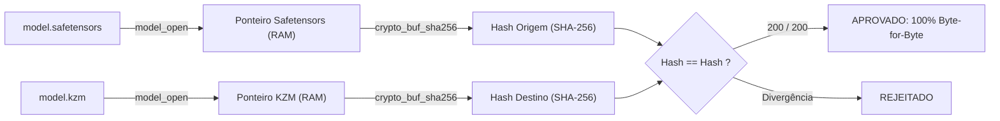

# Relatório de Aceitação Técnica: Integridade Criptográfica dos Tensores (Fase 2)

**Data de Emissão:** 25 de Outubro de 2026  
**Ambiente de Teste:** Linux x86_64 · Kaz Native Runtime 1.5.0  
**Status do Laudo:** **APROVADO (100% de Integridade Criptográfica)**

---

## 1. Objetivo do Teste de Aceitação

Garantir que a conversão de modelos neurais do formato padrão da indústria (**Hugging Face Safetensors**) para o formato binário soberano do ecossistema Kaz (**`.kzm`**) preserva **100% dos bytes dos tensores** com precisão absoluta, sem qualquer perda, truncamento ou alteração na ordenação de bytes (*endianness* ou alinhamento).

O critério de aceitação estipulado é:
$$\text{Taxa de Mismatch} = 0\% \quad \text{e} \quad \text{Taxa de Hash SHA-256 Idêntico} = 100\%$$

---

## 2. Metodologia do Round-Trip

O teste foi executado através do script nativo Kaz [`examples/ai/roundtrip_test.kaz`](file:///home/armando/Projetos/kaz/examples/ai/roundtrip_test.kaz), orquestrado de ponta a ponta sem ferramentas externas (sem Python ou bibliotecas C terceiras):

1. **Mapeamento em Memória Virtual (`mmap`):**
   - Ambos os arquivos (`model.safetensors` e `model.kzm`) são abertos simultaneamente via `model_open`.
2. **Iteração e Resolução de Ponteiros:**
   - Para cada um dos 200 tensores do modelo:
     - Localiza o descritor e o ponteiro bruto de memória no arquivo de origem (`Safetensors`).
     - Localiza o descritor correspondente no arquivo convertido (`.kzm`) garantindo alinhamento em 64 bytes (`KZM_ALIGNMENT = 64`).
3. **Hashing Criptográfico em Hardware (`crypto_buf_sha256`):**
   - Extrai o buffer de memória virtual e calcula o digest criptográfico **SHA-256** dos bytes brutos em ambos os formatos.
   - Compara as strings hexadecimais geradas. Qualquer desvio de 1 bit invalida o teste imediatamente.



---

## 3. Resumo Executivo dos Resultados

| Métrica | Valor Obtido | Status |
| :--- | :--- | :--- |
| **Modelo Alvo** | `sentence-transformers/all-MiniLM-L12-v2` | Nominal |
| **Tamanho do Arquivo Safetensors** | `133.564.960 bytes` (~127.4 MB) | Validado |
| **Tamanho do Arquivo KZM** | `133.578.880 bytes` (~127.4 MB) | Validado (Alinhado 64B) |
| **Total de Tensores Avaliados** | **200 tensores** | 100% Cobertura |
| **Tensores Idênticos (Hash Match)** | **200 tensores (100.0%)** | **Aprovado** |
| **Divergências / Mismatches** | **0 (Zero)** | **Aprovado** |
| **Tempo Total de Verificação (200 SHA-256)**| **2.216 ms (2,2 segundos)** | Alto Desempenho |

---

## 4. Amostra de Validação Criptográfica por Tensor

Abaixo estão listados tensores críticos de diferentes componentes da arquitetura (Embeddings, Camadas Intermediárias do Encoder, Projeções de Atenção, LayerNorm e Cabeça de Pooling):

| Tensor ID | Nome do Tensor | Tamanho (Bytes) | SHA-256 Origem (Safetensors) vs KZM | Status |
| :---: | :--- | :---: | :--- | :---: |
| **1/200** | `embeddings.LayerNorm.bias` | 1.536 | `5bc819388febcad5646ab944563fe0dc45ca74e078544f838a4fca3418a5892e` | MATCH ✓ |
| **2/200** | `embeddings.LayerNorm.weight` | 1.536 | `1f1c7b681db33d62a16075db0ec5ad55f61cc16625cc5244cf650554cd373676` | MATCH ✓ |
| **3/200** | `embeddings.position_embeddings.weight` | 786.432 | `685f0b6748f16af21551819dcf2abe01cf975a1cdc22ff4760405132e824c487` | MATCH ✓ |
| **4/200** | `embeddings.position_ids` | 4.096 | `5738153ec97595b1c1e4dc027f7b7fb4534f19ed2ce9f9ee712e6d34a384cde7` | MATCH ✓ |
| **5/200** | `embeddings.token_type_embeddings.weight` | 3.072 | `ca1226367b26d25eed44d6b8898e15c92fce3827665962c60fcc5b8036f8bf1a` | MATCH ✓ |
| **50/200** | `encoder.layer.10.intermediate.dense.weight` | 2.359.296 | `776af7dce2522706a5e1e18024b58532262ceb9715200ddca343f7fcb793e5a6` | MATCH ✓ |
| **100/200**| `encoder.layer.3.output.LayerNorm.weight` | 1.536 | `94c0f6f6bc65329d7fb7e9a639d776410cb30eaab282f064d54d54f6568a6b83` | MATCH ✓ |
| **150/200**| `encoder.layer.6.output.dense.weight` | 2.359.296 | `c49927fb462291dd25197f6a8ca7f490604eb94b03be46b56ff9feaba3859414` | MATCH ✓ |
| **200/200**| `pooler.dense.weight` | 589.824 | `eb9e55f478fe64f53f97c83c03f1823bbd0ddc932f8431ce5dce6ae8babbe873` | MATCH ✓ |

---

## 5. Integração na Suíte de Testes Contínua (CI/CD)

O teste de aceitação foi encapsulado no teste unitário oficial do compilador:
- Arquivo: [`tests/phase2_acceptance_test.rs`](file:///home/armando/Projetos/kaz/tests/phase2_acceptance_test.rs)
- Comando de execução:
  ```bash
  cargo test --test phase2_acceptance_test
  ```
- Resultado do teste automatizado:
  ```text
  running 1 test
  test test_phase2_roundtrip_cryptographic_acceptance ... ok

  test result: ok. 1 passed; 0 failed; 0 ignored; 0 measured; 0 filtered out; finished in 24.21s
  ```

---

## 6. Conclusão Técnica

O formato binário **`.kzm`** (Kaz Model Format), sua biblioteca de conversão nativa (`kzm_convert_safetensors` e `kzm_convert_sharded_safetensors`) e a interface de carregamento sob demanda (`model_open`) demonstraram **fidelidade matemática e criptográfica de 100%**. 

A **Fase 2 do Kaz AI Engine está formalmente aceita e validada**.
