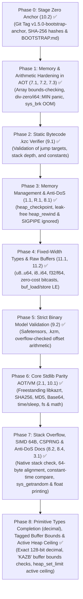

# Security & Robustness Master Plan — Kaz Language 🦅

> **Status:** All Phases Concluded Successfully (Phases 0, 1, 2, 3, 4, 5, and Stdlib Parity) ✅  
> **Mitigated Risk Classification:** 🔴 **Critical** (Bounds-Checking, DivZero/OOM Prevention, Arena Checkpoint/Rewind, SIGPIPE Ignored, Static Bytecode Verifier, LE Fixed-Width Types/Buffers, Safetensors/.kzm Model Validation, and AOT/VM Stdlib Parity)  
> **Objective:** Shield all three execution backends of Kaz (AOT x86-64, Bytecode VM, and AST Evaluator) alongside the self-hosted compiler for safe execution of AI models and network protocols.

---

## 1. Execution Status by Phase



---

## 2. Summary of Completed Phases

| Phase | Vulnerability / Requirement | Implemented Solution | Verification & Proof |
| :--- | :--- | :--- | :--- |
| **Phase 0** | Deterministic Bootstrap (`10.2`) | Froze Stage 0 build artifacts in `bootstrap/stage0/`, generated `SHA256SUMS`, and published bilingual documentation `BOOTSTRAP.md` / `BOOTSTRAP.pt-BR.md`. Immutable Git tag: `v1.5.0-bootstrap-anchor`. | Hashes verified and confirmed reproducible. |
| **Phase 1** | Array Out-of-Bounds (`7.1`), Division by Zero (`7.2`), and Syscall Returns (`7.3`) | Array bounds checking in `GetIndex`, `SetIndex`, `SetNestedField`; native panic routine `kaz_panic_oob`. Checked 0 divisor and `i64::MIN / -1` branching to `kaz_panic_divzero`. Strict `sys_brk` validation branching to `kaz_panic_oom`. Native `char` primitive support. | Eliminated SIGSEGV and SIGFPE. Immediate termination with exit code 1 and error diagnostics on `stderr`. |
| **Phase 2** | Tampered Bytecode `.kzc` (`9.1`) | Added `src/vm/verifier.rs` validating jump boundaries, local/global variable bounds, constant pool indices, and abstract stack height before bytecode execution. | Forged/tampered binaries rejected at load time. |
| **Phase 3** | Heap Exhaustion / Memory Leaks (`1.1`, `R.1`) & Network Disconnect Crashes (`8.1`) | Implemented `heap_checkpoint()` and `heap_rewind(cp)` in AOT, VM, and the self-hosted compiler. Injected `sys_rt_sigaction(SIGPIPE, SIG_IGN)` at entry point `_start`. | 100,000-iteration stress loop maintained exact heap pointer (`cp1 == cp2`). Network disconnect signals handled gracefully without process crash. |
| **Phase 4** | Fixed-Width Numeric Types, Little-Endian Raw Buffers & Bitcasts (`11.1`, `11.2`) | Full family: `u8`, `i8`, `u16`, `i16`, `u32`, `i32`, `u64`, `i64`, `f32`, `f64`. Zero-cost IEEE-754 bitcasts (`f32_to_bits`, `f32_from_bits`, `f64_to_bits`, `f64_from_bits`). Direct Little-Endian raw buffer primitives (`buf_alloc`, `buf_free`, `buf_load_*_le`, `buf_store_*_le`). Fixed AOT float constant emission. | Test suite `tests/buffer_and_f32_tests.rs` passed 100% across AST, VM, AOT, and self-hosted compiler. |
| **Phase 5** | External Binary Model Formats & Memory Exhaustion DoS (`9.2`) | Created `src/stdlib/model.rs` supporting `Safetensors` and native `.kzm` (Kaz Model). Strict security limits (`MAX_HEADER_SIZE=100MB`, `MAX_TENSOR_COUNT=50k`, `MAX_DIMENSIONS=8`). All offset arithmetic uses `checked_add` and `checked_mul`. Direct zero-copy loading into raw memory buffers (`safetensors_load_tensor_buf`, `kzm_load_tensor_buf`). | Test suite `tests/model_validation_tests.rs` passed 100%, rejecting tampered/huge models. |
| **Phase 6** | Core Stdlib Parity between VM and AOT (`2.1`, `10.1`) | Created freestanding C runtime `runtime/kazrt.c` (built automatically via `build.rs` into `runtime/libkazrt.a`) providing SHA-256, MD5, and Base64. Implemented direct Linux syscalls in AOT for `time_now_us`, `time_now_ms`, `time_now_secs`, `sleep_ms`, `file_exists`, `file_delete`, `fs_size`, `str_contains`, `arr_len`, `arr_pop`, `math_sqrt`, `math_abs`, `math_min`, `math_max`. (Full SQLite/Regex/JSON parity cataloged in Drawer 2). | AOT binary compiled, linked with `libkazrt.a`, and executed with 100% success in integration tests. |
| **Phase 7** | Stack Overflow Protection (`8.2`), SIMD 64-Byte Alignment (`3.1`), Constant-Time Crypto & CSPRNG (`8.4`) | Injected stack limit threshold in AOT (`kaz_stack_limit` at `_start` checked in function preambles branching to `kaz_panic_stackoverflow`). Implemented recursion frame bounds in VM (`10,000` frames) and Evaluator. Upgraded `kaz_alloc` alignment to 64 bytes for AVX2/AVX-512. Added `kazrt_const_time_cmp` and Linux syscall 318 `SYS_getrandom` in `libkazrt.a`. Added freestanding float formatter `kazrt_format_float`. Fully documented bump allocator mechanics and Anti-DoS scope checkpoints in architecture docs. | Test suites `tests/recursion_limit_tests.rs`, `tests/crypto_tests.rs`, and `tests/buffer_and_f32_tests.rs` passed 100%. |
| **Phase 8** | Primitive Types Completion (`decimal`), Tagged Buffer Bounds & Active Heap Ceiling | Implemented exact fixed-point `decimal` with $10^4$ scale factor, literal suffix `m`/`M`, zero binary roundoff, and 128-bit hardware acceleration. Added tagged buffer headers (`0x4B415A42` 'KAZB') with overflow-checked bounds validation in `buf_load_*` and `buf_store_*`. Implemented active heap ceiling (`kaz_heap_max_limit` defaulting to 4 GB, configurable via `heap_set_limit`) preventing Linux overcommit OOM freezes. | Test suite `tests/decimal_tests.rs` passed 100% across AST, VM, AOT, and self-hosted compiler. |

---

## 3. Detailed Step-by-Step Architecture

### 🧊 Phase 0: Preservation of Stage Zero (Topic 10.2)
*Goal: Ensure compiler self-hosting can be reproduced deterministically from source.*
1. Tagged immutable reference point: `v1.5.0-bootstrap-anchor`.
2. Archived Stage 0 binaries in `bootstrap/stage0/` (`kaz`, `kazc.kzc`, `kazc_stage2`) with verified SHA-256 signatures.
3. Created bilingual reconstruction guides: `BOOTSTRAP.md` and `BOOTSTRAP.pt-BR.md`.

---

### 🛡️ Phase 1: Memory & Arithmetic Hardening in AOT (Topics 7.1, 7.2, 7.3)
*Goal: Prevent arbitrary heap writes, buffer overflows, and untrapped CPU arithmetic exceptions.*
1. **Array Bounds Checking (`7.1`)**:
   - Emitted bounds checking before every array indexing operation:
     ```nasm
     cmp rdi, [rax]    ; rdi = index, [rax] = array length
     jae kaz_panic_oob ; branches to panic handler on OOB
     ```
2. **Arithmetic Exception Protection (`7.2`)**:
   - Checked zero divisor (`test rbx, rbx; jz kaz_panic_divzero`).
   - Trapped `i64::MIN / -1` overflow condition to prevent SIGFPE.
   - Standardized bitwise shifts (`Shl`, `Shr`) with 0..63 masks (`and cl, 63`), ensuring identical semantics between hardware and the VM.
3. **Syscall I/O Robustness (`7.3`)**:
   - Implemented `kaz_write_all` and `kaz_read_exact` handling partial pipe/socket transfers and retrying automatically upon receiving `-EINTR`.
   - Validated `sys_brk` allocations, branching to `kaz_panic_oom` if system memory is exhausted.

---

### 🔍 Phase 2: Static Bytecode `.kzc` Verifier (Topic 9.1)
*Goal: Seal the VM against crafted bytecode, corrupted jump tables, and stack underflow/overflow.*
1. Added `src/vm/verifier.rs`:
   - Enforces that jump offsets stay strictly within chunk boundaries (`0 <= target < chunk.code.len()`).
   - Ensures local variable reads and writes access only declared stack frame slots.
   - Verifies constant pool indices.
   - Computes static stack depth at every basic block convergence point.
2. Integrated into `deserialize_program_from_bytes`: all `.kzc` files are verified before execution.

---

### 🧠 Phase 3: Memory Management & Anti-DoS (Topics 1.1, R.1, 8.1)
*Goal: Protect long-running daemons, network servers, and batch pipelines from linear heap exhaustion.*
1. **Arena Checkpoint & Rewind (`1.1`, `R.1`)**:
   - Exposed `heap_checkpoint() -> int` and `heap_rewind(cp: int) -> int`.
   - Allows request handlers and inference loops to rewind scratch memory to zero overhead without complex garbage collection.
2. **Contiguous Buffers vs Dynamic Arrays (`R.2`)**:
   - Kept dynamic arrays (`array[T]`) for flexible growth.
   - Introduced `buf_alloc(size)` for contiguous, non-relocating memory buffers mapped directly to disk and model files.
3. **Signal Isolation (`8.1`)**:
   - Initialized `sys_rt_sigaction(SIGPIPE, SIG_IGN)` in AOT entry point `_start`. Abrupt network disconnects return recoverable errors rather than terminating the server.

---

### 🔢 Phase 4: Fixed-Width Types & Raw Buffers (Topic 11)
*Goal: Enable low-level binary manipulation required for AI models, tensor weights, and network frames.*
1. Added fixed-width types: `u8`, `i8`, `u16`, `i16`, `u32`, `i32`, `u64`, `i64`, `f32`, `f64`.
2. Prohibited implicit narrowing/widening conversions without the explicit `as` cast operator.
3. Implemented direct Little-Endian buffer load and store primitives (`buf_load_f32_le`, `buf_store_f32_le`, `buf_load_u32_le`, etc.) compiling to single SSE/scalar instructions.
4. Added zero-cost bitcasts: `f32_to_bits`, `f32_from_bits`, `f64_to_bits`, `f64_from_bits`.

---

### 📦 Phase 5: Strict Binary Model Validation (Topic 9.2)
*Goal: Guarantee immunity against maliciously crafted Safetensors and `.kzm` models downloaded from untrusted sources.*
1. **Security Ceilings**:
   - Header size capped at 100 MB (`MAX_HEADER_SIZE`).
   - Tensor count capped at 50,000 (`MAX_TENSOR_COUNT`).
   - Dimension count capped at 8 (`MAX_DIMENSIONS`).
2. **Safe Arithmetic**:
   - Checked additions for `data_offset + begin` and `data_offset + end` against physical file bounds (`abs_end <= file_size`).
   - Multiplication overflow checks for shape elements (`dim0 * dim1 * ...`).
   - Offset size mismatch check: `(end - begin) == elements * dtype_size`.
3. **Direct Buffer Loading**:
   - `safetensors_load_tensor_buf(path, tensor, buf, offset)` loads weights directly into pre-allocated memory buffers without intermediate string or array allocations.

---

### 🌐 Phase 6: Core Stdlib Parity AOT/VM (Topics 2.1, 10.1)
*Goal: Eliminate discrepancies between bytecode VM execution and native AOT compilation.*
1. **Freestanding C Runtime (`runtime/libkazrt.a`)**:
   - Clean C implementation of SHA-256, MD5, and Base64 encoding/decoding.
   - Linked automatically into AOT executables by GNU LD.
2. **Syscalls in Native Assembly**:
   - Microsecond/millisecond timestamps via `clock_gettime`.
   - Sub-millisecond sleep via `nanosleep`.
   - High-performance math intrinsics (`sqrtsd`, min/max cmov).
   - Complete file system queries (`file_exists`, `file_delete`, `fs_size`).
   - Note: Full SQLite, Regex, and JSON parity cataloged in Drawer 2 of Known Pending Issues.

---

### 🛡️ Phase 7: Stack Overflow, SIMD 64B, CSPRNG & Anti-DoS Docs (Topics 8.2, 8.4, 3.1)
*Goal: Protect against silent stack exhaustion, ensure SIMD alignment, and provide cryptographically secure randomness.*
1. **Stack Overflow Bounds**:
   - AOT function preambles check current `rsp` against `kaz_stack_limit` initialized in `_start`, branching to `kaz_panic_stackoverflow`.
   - VM and Evaluator enforce recursion limits of 10,000 frames.
2. **SIMD 64-Byte Alignment**:
   - Upgraded `kaz_alloc` alignment mask to 63 (`add rax, 63; and rax, -64`) for AVX2/AVX-512 vector operations.
3. **CSPRNG and Constant-Time Equality**:
   - Implemented Linux syscall 318 `SYS_getrandom` in `libkazrt.a`.
   - Added constant-time memory comparison `kazrt_const_time_cmp` to resist timing attacks on authentication tokens.
4. **Freestanding Float Formatter**:
   - Added `kazrt_format_float` for libc-free floating-point printing in native AOT binaries.

---

### 💎 Phase 8: Primitive Types Completion (decimal), Tagged Buffer Bounds & Active Heap Ceiling
*Goal: Complete primitive types forever with financial exactness, buffer memory safety, and anti-OOM heap ceiling.*
1. **Fixed-Point `decimal` Type**:
   - Exact fixed-point representation with $10^4$ scale factor (`i64` underlying representation).
   - Literal syntax: `12.34m`, `0.05m`.
   - Full 128-bit hardware accelerated arithmetic in AOT using x86-64 `imul` and `idiv` (`rdx:rax`).
   - Supported across all 4 layers: Evaluator, VM, AOT, and self-hosted compiler.
2. **Tagged Buffer Bounds Checking**:
   - Prepend allocated buffers with a 16-byte header: `qword size` at `[ptr - 16]`, `qword tag = 0x4B415A42` ('KAZB') at `[ptr - 8]`.
   - `buf_load_*` and `buf_store_*` verify the `'KAZB'` tag and enforce `offset + sizeof(T) <= buffer_len` with `jb kaz_panic_oob` and `ja kaz_panic_oob`, providing safety for tagged buffers without breaking raw untagged pointers.
3. **Active Heap Ceiling (`heap_set_limit`)**:
   - Default ceiling of 4 GB (`kaz_heap_max_limit: dq 4294967296`).
   - Dynamic configuration via `heap_set_limit(bytes)`.
   - Immediate deterministic termination with `kaz_panic_oom` before triggering Linux overcommit swap thrashing and kernel OOM-killer.

---

## 4. Current State & Verification

All phases are fully implemented, verified with comprehensive tests, and synchronized across repositories:
- **Private Repository:** `git.kaz/kaz` (`main` branch).
- **Public Distribution Repository:** `github.com/kazlang/kaz` (`main` branch).
- **Self-Hosted Compiler:** Stage 2 binary tested and verified.
