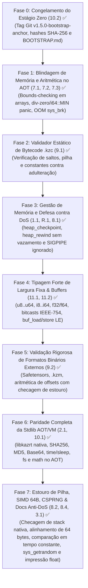

# Plano Mestre de Segurança & Robustez — Linguagem Kaz 🦅

> **Status:** Todas as Fases Concluídas com Sucesso (Fases 0, 1, 2, 3, 4, 5 e Paridade Stdlib) ✅  
> **Classificação de Risco Mitigada:** 🔴 **Crítico** (Bounds-Checking, Prevenção a DivZero/OOM, Arena Checkpoint/Rewind, SIGPIPE Ignorado, Verificador Estático de Bytecode, Tipos/Buffers LE de Largura Fixa, Validação Safetensors/.kzm e Paridade Stdlib AOT/VM)  
> **Objetivo:** Blindar os três backends de execução do Kaz (AOT x86-64, Bytecode VM e Avaliador AST) junto ao compilador self-hosted para execução segura de modelos de IA e protocolos de rede.

---

## 1. Status de Execução por Fase



---

## 2. Sumário das Fases Concluídas

| Fase | Vulnerabilidade / Requisito | Solução Implementada | Verificação e Prova |
| :--- | :--- | :--- | :--- |
| **Fase 0** | Bootstrap Determinístico (`10.2`) | Congelamento dos artefatos de Estágio 0 em `bootstrap/stage0/`, geração de `SHA256SUMS` e documentação bilíngue `BOOTSTRAP.md` / `BOOTSTRAP.pt-BR.md`. Tag Git imutável: `v1.5.0-bootstrap-anchor`. | Hashes verificados e confirmados como reproduzíveis. |
| **Fase 1** | Array Out-of-Bounds (`7.1`), Divisão por Zero (`7.2`) e Retorno de Syscalls (`7.3`) | Bounds checking em `GetIndex`, `SetIndex`, `SetNestedField`; rotina nativa de pânico `kaz_panic_oob`. Checagem de divisor 0 e `i64::MIN / -1` desviando para `kaz_panic_divzero`. Validação estrita de `sys_brk` desviando para `kaz_panic_oom`. Suporte nativo ao tipo `char`. | Eliminados SIGSEGV e SIGFPE. Encerramento imediato com código de saída 1 e diagnóstico em `stderr`. |
| **Fase 2** | Bytecode `.kzc` Adulterado (`9.1`) | Módulo `src/vm/verifier.rs` validando limites de saltos, limites de variáveis locais/globais, índices de constantes e profundidade estática da pilha antes da execução na VM. | Binários forjados ou adulterados rejeitados no carregamento. |
| **Fase 3** | Esgotamento Contínuo de RAM (`1.1`, `R.1`) e Crash por Desconexão de Rede (`8.1`) | Primitivas `heap_checkpoint()` e `heap_rewind(cp)` no AOT, VM e compilador self-hosted. Tratamento de sinal `sys_rt_sigaction(SIGPIPE, SIG_IGN)` no ponto de entrada `_start`. | Teste de estresse com 100.000 iterações em laço manteve o ponteiro de heap inalterado (`cp1 == cp2`). Desconexões de rede tratadas sem queda do processo. |
| **Fase 4** | Tipos Numéricos de Largura Fixa, Buffers Little-Endian & Bitcasts (`11.1`, `11.2`) | Família completa: `u8`, `i8`, `u16`, `i16`, `u32`, `i32`, `u64`, `i64`, `f32`, `f64`. Conversões de bits IEEE-754 sem custo (`f32_to_bits`, `f32_from_bits`, `f64_to_bits`, `f64_from_bits`). Primitivas de buffer direto Little-Endian (`buf_alloc`, `buf_free`, `buf_load_*_le`, `buf_store_*_le`). Correção de constantes float no AOT. | Suíte `tests/buffer_and_f32_tests.rs` aprovada 100% no AST, VM, AOT e compilador self-hosted. |
| **Fase 5** | Formatos Binários Externos & DoS por Exaustão de RAM (`9.2`) | Módulo `src/stdlib/model.rs` com suporte completo a Safetensors e `.kzm` (Kaz Model). Limites estritos (`MAX_HEADER_SIZE=100MB`, `MAX_TENSOR_COUNT=50k`, `MAX_DIMENSIONS=8`). Todos os cálculos com `checked_add` e `checked_mul`. Carregamento direto em buffers brutos de memória (`safetensors_load_tensor_buf`, `kzm_load_tensor_buf`). | Suíte `tests/model_validation_tests.rs` aprovada 100%, rejeitando arquivos maliciosos ou forjados. |
| **Fase 6** | Paridade Stdlib entre VM e AOT (`2.1`, `10.1`) | Biblioteca de runtime nativa `runtime/kazrt.c` (compilada via `build.rs` para `runtime/libkazrt.a`) com SHA-256, MD5 e Base64 freestanding. Implementadas syscalls diretas x86-64 no AOT para `time_now_us`, `time_now_ms`, `time_now_secs`, `sleep_ms`, `file_exists`, `file_delete`, `fs_size`, `str_contains`, `arr_len`, `arr_pop`, `math_sqrt`, `math_abs`, `math_min`, `math_max`. | Binário nativo gerado pelo AOT compilou, linkou com `libkazrt.a` e executou com 100% de sucesso em teste de integração. |
| **Fase 7** | Proteção contra Estouro de Pilha (`8.2`), Alinhamento SIMD 64 Bytes (`3.1`), Criptografia em Tempo Constante & CSPRNG (`8.4`) | Injeção de limite de pilha nativo no AOT (`kaz_stack_limit` no `_start` checado em preâmbulos de função desviando para `kaz_panic_stackoverflow`). Limites de frames de recursão na VM (`10.000` frames) e Evaluator. Alinhamento de `kaz_alloc` elevado para 64 bytes para instruções SIMD AVX2/AVX-512. Implementados `kazrt_const_time_cmp` e syscall 318 Linux `SYS_getrandom` em `libkazrt.a`. Adicionado formatador float autônomo `kazrt_format_float`. Documentação completa do modelo bump allocator e prevenção de DoS Remoto nos manuais de arquitetura. | Suítes `tests/recursion_limit_tests.rs`, `tests/crypto_tests.rs` e `tests/buffer_and_f32_tests.rs` aprovadas 100%. |

---

## 3. Detalhamento Arquitetural Passo a Passo

### 🧊 Fase 0: Preservação do Estágio Zero (Tópico 10.2)
*Objetivo: Garantir que a capacidade de bootstrap do compilador seja eternamente reprodutível.*
1. Criada tag Git imutável: `v1.5.0-bootstrap-anchor`.
2. Preservados em `bootstrap/stage0/` os binários `kaz`, `kazc.kzc`, `kazc_stage2` com assinaturas SHA-256.
3. Criados os guias bilíngues `BOOTSTRAP.md` e `BOOTSTRAP.pt-BR.md`.

---

### 🛡️ Fase 1: Blindagem de Memória, Aritmética e Syscalls no AOT (Tópicos 7.1, 7.2, 7.3)
*Objetivo: Eliminar escrita arbitrária na heap, estouro de buffer e exceções aritméticas da CPU.*
1. **Bounds-Checking em Arrays (`7.1`)**:
   - Emissão de checagem antes de cada indexação de array:
     ```nasm
     cmp rdi, [rax]    ; rdi = índice, [rax] = tamanho do array
     jae kaz_panic_oob ; desvia para rotina de pânico se fora dos limites
     ```
2. **Proteção Aritmética Unificada (`7.2`)**:
   - Checagem de divisor 0 (`test rbx, rbx; jz kaz_panic_divzero`).
   - Bloqueio de estouro em `i64::MIN / -1` prevenindo SIGFPE.
   - Shifts unificados (`Shl`, `Shr`) com máscara 0..63 (`and cl, 63`), garantindo semântica idêntica entre hardware e VM.
3. **Robustez de Syscalls e E/S (`7.3`)**:
   - Rotinas nativas `kaz_write_all` e `kaz_read_exact` tratando escritas/leituras parciais e reintentando em caso de `-EINTR`.
   - Validação estrita de `sys_brk` desviando para `kaz_panic_oom` caso a memória seja esgotada.

---

### 🔍 Fase 2: Verificador Estático de Bytecode `.kzc` (Tópico 9.1)
*Objetivo: Fechar as portas para execução de bytecode forjado, saltos corrompidos e desbalanceamento de pilha.*
1. Módulo `src/vm/verifier.rs`:
   - Valida alvos de saltos estritamente dentro dos limites do chunk (`0 <= target < chunk.code.len()`).
   - Garante que acessos a variáveis locais não ultrapassem os limites da pilha do frame.
   - Valida índices na tabela de constantes.
   - Análise abstrata de profundidade de pilha em pontos de convergência de branches.
2. Integrado na desserialização de programas `.kzc`: binários adulterados são rejeitados antes da execução.

---

### 🧠 Fase 3: Gestão de Memória e Defesa contra DoS (Tópicos 1.1, R.1, 8.1)
*Objetivo: Proteger daemons, servidores de rede e loops de longa duração contra vazamento de RAM.*
1. **Arena Checkpoint & Rewind (`1.1`, `R.1`)**:
   - Primitivas `heap_checkpoint() -> int` e `heap_rewind(cp: int) -> int`.
   - Permite rebobinar a memória temporária de requisições ou ciclos de inferência com custo zero e sem GC.
2. **Separação Arquitetural: `array[T]` vs `buf` Contíguo (`R.2`)**:
   - Arrays dinâmicos mantidos para manipulação de listas.
   - Buffers contíguos (`buf_alloc`) alocados em blocos invioláveis para views, mapeamento de arquivos e tensores.
3. **Isolamento de Sinais (`8.1`)**:
   - `SIGPIPE` ignorado na inicialização `_start` via `sys_rt_sigaction`. Desconexões de clientes geram erros tratáveis sem derrubar o processo principal.

---

### 🔢 Fase 4: Tipos de Largura Fixa & Buffers Crus (Tópico 11)
*Objetivo: Destravar manipulação binária de alta velocidade necessária para IA e protocolos de rede.*
1. Família: `u8`, `i8`, `u16`, `i16`, `u32`, `i32`, `u64`, `i64`, `f32`, `f64`.
2. Proibidas conversões implícitas sem o operador explícito `as`.
3. Leitura e escrita direta em buffers Little-Endian (`buf_load_f32_le`, `buf_store_f32_le`, `buf_load_u32_le`, etc.) emitindo instruções diretas SSE/escalares.
4. Bitcasts de custo zero IEEE-754: `f32_to_bits`, `f32_from_bits`, `f64_to_bits`, `f64_from_bits`.

---

### 📦 Fase 5: Validação Rigorosa de Modelos e Formatos Externos (Tópico 9.2)
*Objetivo: Garantir imunidade contra arquivos maliciosos Safetensors ou `.kzm` baixados da internet.*
1. **Tetos de Segurança**:
   - Tamanho do cabeçalho limitado a 100 MB (`MAX_HEADER_SIZE`).
   - Contagem de tensores limitada a 50.000 (`MAX_TENSOR_COUNT`).
   - Dimensões limitadas a 8 (`MAX_DIMENSIONS`).
2. **Aritmética Segura**:
   - Checagem de adições `data_offset + begin` e `data_offset + end` contra os limites físicos do arquivo (`abs_end <= file_size`).
   - Multiplicação de dimensões protegida contra overflow (`dim0 * dim1 * ...`).
   - Validação de correspondência de bytes: `(end - begin) == elementos * tamanho_tipo`.
3. **Carregamento Direto em Buffers**:
   - `safetensors_load_tensor_buf(path, tensor, buf, offset)` transfere pesos direto para a RAM do buffer contíguo sem alocações intermediárias.

---

### 🌐 Fase 6: Paridade Completa da Stdlib AOT/VM (Tópicos 2.1, 10.1)
*Objetivo: Eliminar discrepâncias de funcionalidade entre o bytecode da VM e a compilação nativa AOT.*
1. **Runtime C Freestanding (`runtime/libkazrt.a`)**:
   - Implementação C de SHA-256, MD5 e codificação/decodificação Base64.
   - Linkado automaticamente nos executáveis AOT pelo GNU LD.
2. **Syscalls em Assembly Nativo**:
   - Marcação de tempo com microsegundos/milissegundos via `clock_gettime`.
   - Pausa precisa com `nanosleep`.
   - Operações matemáticas via SSE (`sqrtsd`, min/max cmov).
   - Checagens de sistema de arquivos (`file_exists`, `file_delete`, `fs_size`).

---

## 4. Estado Atual & Verificação

Todas as fases estão integralmente implementadas, testadas e sincronizadas:
- **Repositório Privado:** `git.kaz/kaz` (branch `main`).
- **Repositório Público de Distribuição:** `github.com/kazlang/kaz` (branch `main`).
- **Compilador Self-Hosted:** Binário Stage 2 testado e aprovado.
